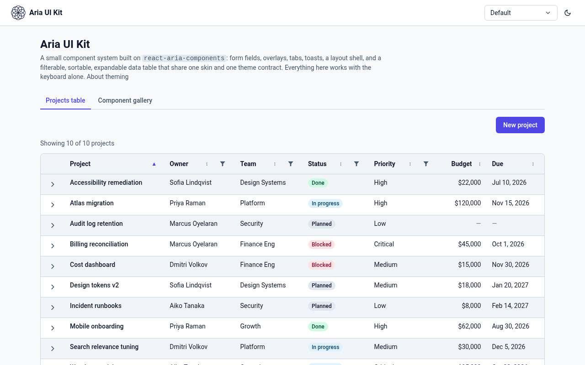
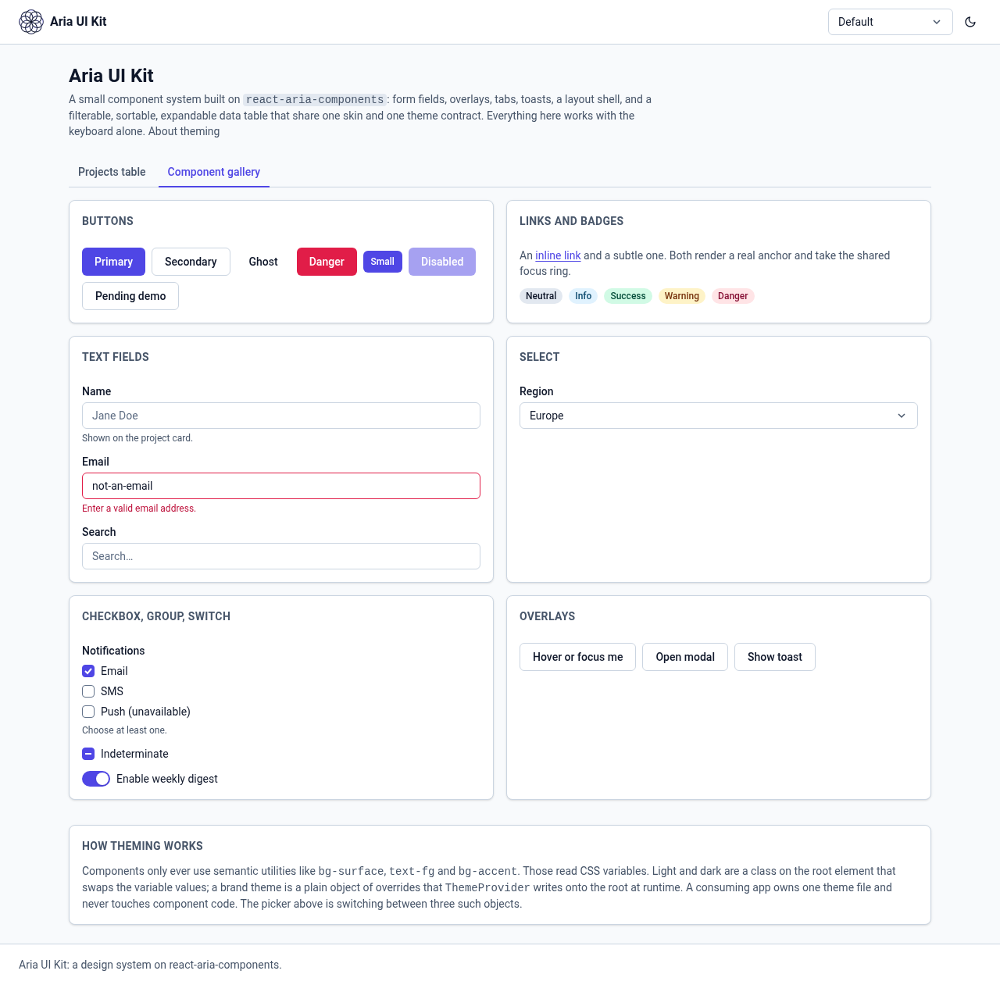
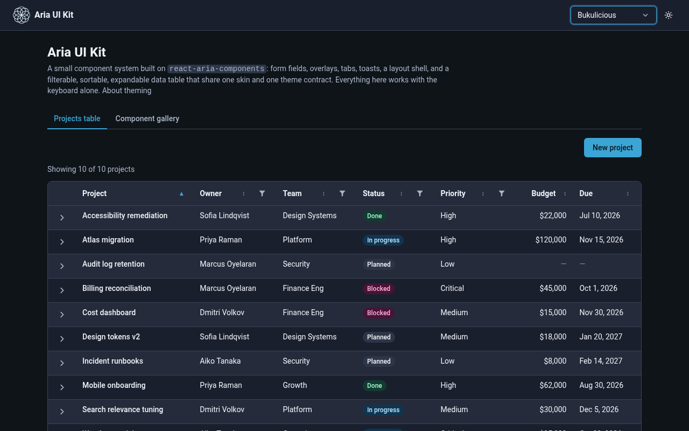

# Aria UI Kit

A small component system built on [`react-aria-components`](https://react-spectrum.adobe.com/react-aria/):
form fields, overlays, navigation, notifications, and a filterable, sortable, expandable data table,
all sharing one Tailwind skin and one set of design tokens. Storybook for the components, Vitest for
the behavior, axe for the accessibility tree.

> **What this is, and isn't.** This is a work sample. It recreates, from scratch and in a generic
> domain, the architecture of a proprietary component library I built and maintained: adopt React
> Aria as the accessible foundation, own the visual layer and the data logic on top, and ship it as
> a shared package that many apps consume. It is **not** that library's source and contains none of
> it. The sample data (a fictional project tracker) is invented.







```
pnpm install
pnpm dev              # demo page at http://localhost:5173
pnpm storybook        # stories + a11y addon at http://localhost:6006
pnpm test             # unit + keyboard + axe tests
```

## Theming: one contract, one file per app

This is the part that makes it a _system_ rather than a pile of components.

- **Components never name a color.** They use semantic utilities: `bg-surface`, `text-fg`,
  `border-edge`, `bg-accent text-accent-fg`, `bg-danger-soft`. Those are defined once in
  `src/theme/tokens.css` via Tailwind's `@theme inline`, and each one reads a CSS variable
  (`--ui-surface`, `--ui-fg`, …).
- **Light/dark is a class.** `tokens.css` sets the variables on `:root` and again under `.dark`.
  `ThemeModeProvider` owns that class: it reads a stored preference, falls back to
  `prefers-color-scheme`, follows OS changes live, and persists. `ThemeToggle` is the sun/moon
  button in the top right of the demo.
- **A brand theme is a plain object.** `ThemeConfig` is `{ id, name, light: overrides, dark: overrides }`.
  `ThemeProvider` writes the current mode's overrides onto `<html>` as inline custom properties,
  which beat the stylesheet defaults, so swapping the `theme` prop re-skins everything at runtime
  with no build step. A consuming app owns exactly one such file and never touches component code.
- **Three themes ship:** `default` (overrides nothing), `bukulicious` (my personal brand: cyan and
  pink on deep blue-black), and `fire` (orange/red on near-black). The demo's picker switches
  between them; Storybook has Mode and Theme toolbar controls.
- **Contrast is a test, not a hope.** `src/theme/contrast.test.ts` computes WCAG ratios for every
  theme × mode across the text/background pairs the components actually produce. It caught the
  brand cyan and pink both failing AA under white text, which is why light mode uses a deeper cyan
  and why dark mode puts dark text on the true cyan instead.

```tsx
import { ThemeModeProvider, ThemeProvider, ThemeToggle, type ThemeConfig } from '@burntlotuslabs/aria-ui-kit'

const myBrand: ThemeConfig = {
  id: 'acme', name: 'Acme',
  light: { accent: '#0f766e', 'accent-hover': '#115e59', 'accent-fg': '#fff', focus: '#0f766e' },
  dark:  { accent: '#5eead4', 'accent-hover': '#99f6e4', 'accent-fg': '#042f2e', focus: '#5eead4' },
}

<ThemeModeProvider>
  <ThemeProvider theme={myBrand}>
    <App />            {/* put <ThemeToggle /> wherever the header is */}
  </ThemeProvider>
</ThemeModeProvider>
```

## What's in the kit

| Component                                           | Built on                                                               | What React Aria gives you                                                                           | What's written here                                                                                                      |
| --------------------------------------------------- | ---------------------------------------------------------------------- | --------------------------------------------------------------------------------------------------- | ------------------------------------------------------------------------------------------------------------------------ |
| `Button`                                            | `Button`                                                               | Unified press events (mouse/touch/keyboard/AT), `isPending` with live announcement                  | Variants, sizes                                                                                                          |
| `Badge`                                             | plain `span`                                                           | nothing needed; it's static text                                                                    | Tones                                                                                                                    |
| `Card`                                              | plain `div`                                                            | nothing needed; static layout                                                                       | Surface, border, optional heading                                                                                        |
| `Link`                                              | `Link`                                                                 | Real `<a>` with `href`, `role="link"` without, router integration                                   | Variants                                                                                                                 |
| `TextField`, `SearchField`                          | `TextField`, `SearchField`                                             | Label/description/error association, `aria-invalid`, native + ARIA validation, Escape-to-clear      | Field chrome, textarea mode                                                                                              |
| `Select`, `SelectItem`                              | `Select`, `ListBox`, `Popover`                                         | Listbox semantics, typeahead, arrow/Home/End, hidden native select for forms                        | Trigger + option skin                                                                                                    |
| `Checkbox`, `CheckboxGroup`                         | `Checkbox`, `CheckboxGroup`                                            | Group role, indeterminate, validation                                                               | Custom indicator                                                                                                         |
| `Switch`                                            | `Switch`                                                               | `role="switch"`, Space toggles                                                                      | Track + thumb                                                                                                            |
| `Tooltip`                                           | `Tooltip`, `TooltipTrigger`                                            | Opens on focus _and_ hover, warm-up delay, `aria-describedby`, Escape                               | Skin + arrow                                                                                                             |
| `Modal`                                             | `ModalOverlay`, `Modal`, `Dialog`                                      | Focus trap and restore, Escape, scroll lock, outside content hidden from AT                         | Title bar, close button, `close` render prop                                                                             |
| `Tabs`                                              | `Tabs`, `TabList`, `Tab`, `TabPanel`                                   | Tab/panel association, arrow keys, automatic activation                                             | Skin                                                                                                                     |
| `ThemeModeProvider`, `ThemeProvider`, `ThemeToggle` |                                                                        |                                                                                                     | Mode state, persistence, OS sync; runtime token overrides; the toggle button (built from the kit's `Button` + `Tooltip`) |
| `Logo`                                              | inline SVG                                                             | nothing needed; it is an image with a name (or `aria-hidden` when decorative)                       | A generic circles mark to swap for your own; painted from tokens so it follows mode and brand theme             |
| `AppShell`, `SkipLink`                              | `DialogTrigger`, `ModalOverlay`, `Modal`, `Dialog` for the drawer      | Drawer focus trap and restore, Escape, scroll lock, outside content hidden from AT                  | Landmarks (banner, main, contentinfo), skip link that moves focus into main, sidebar that becomes a drawer below `md`    |
| `Container`, `Stack`, `Cluster`, `Grid`             | plain `div`                                                            | nothing needed; static layout                                                                       | Width cap and gutters, vertical rhythm, wrapping groups, breakpoint-free responsive grid                                 |
| `Toaster`, `toast`                                  | `Toast*` (still `UNSTABLE_` in this version)                           | Live region, F6 to jump to it, focus handling on dismiss, timers pause on hover/focus               | Queue singleton, tones. One file wraps the unstable API                                                                  |
| `Table` suite                                       | `Table`, `Column`, `Row`, `Cell` …                                     | Full ARIA grid: roles, `aria-sort`, roving focus, arrows, Home/End (cells), Ctrl+Home/End (rows), typeahead, selection | Skin, sort indicator, and see below                                                                                      |
| `FilterDropdown`                                    | `Popover`, `Dialog` + the kit's `SearchField`/`CheckboxGroup`/`Button` | Popover placement, focus trap, dismissal                                                            | Search, option list, OR/AND filter logic                                                                                 |
| `ExpandToggle` + `useExpandedRows`                  | the kit's `Button`                                                     |                                                                                                     | Expandable rows as sibling detail rows with `aria-expanded`/`aria-controls`                                              |
| `sortRows`                                          |                                                                        |                                                                                                     | The comparator. React Aria gives you a `sortDescriptor`; it does not sort                                                |

### How this maps to the original library

The proprietary library this recreates had, by directory: badge, button, card, checkbox, input,
link, logo, layout, modal, select, table, tabs, theme, toast, toggle, tooltip. This kit now has an
equivalent for every one. `Logo` is a generic circles mark as inline SVG painted from the theme tokens
(or the artwork colors), and the layout pieces are an `AppShell` (skip link, landmarks, responsive
drawer) plus `Container`, `Stack`, `Cluster` and `Grid`. The table suite here goes further than a
wrapper (filters, expansion, typed sorting), and the theming layer follows the same design as the
original: a CSS-variable contract, a runtime provider for brand overrides, and a mode toggle.

### Conventions every component follows

- **Thin wrappers.** Each component forwards all React Aria props unchanged and only adds a
  `className` (merged with `composeRenderProps`, so consumers can still pass render-prop classes)
  and a few ergonomic props like `label`, `description`, `errorMessage`, `variant`.
- **State is styled through data attributes**, never through JS: `data-[selected]`,
  `data-[focus-visible]`, `data-[pending]`, `data-[invalid]`, `data-[open]`. React Aria sets them;
  Tailwind reads them.
- **Tokens, not palette.** Components reference semantic tokens only (`surface`, `fg`, `accent`,
  `danger-soft`, …), never `slate-500` or a hex. See Theming above.
- **One focus ring.** `src/lib/styles.ts` holds the shared focus-ring and field-chrome fragments so
  every control looks and behaves the same under keyboard focus.
- **The kit eats its own cooking.** `FilterDropdown`, `ExpandToggle`, the "New project" form and
  the table toolbar are built from the primitives, not from raw React Aria.

## The decision: why React Aria

Admin-style products are forms, overlays and tables. All of it has to work for keyboard and
screen-reader users, and that is the part hand-rolled UI gets wrong: a `<div>` menu that doesn't
trap focus, a sort handler with no `aria-sort`, a tooltip that only opens on hover.

| Option                                            | You get                                                                | You own                                                                                 |
| ------------------------------------------------- | ---------------------------------------------------------------------- | --------------------------------------------------------------------------------------- |
| **Build from scratch**                            | Total control                                                          | Every ARIA pattern, and every bug in them                                               |
| **A styled kit** (MUI, Chakra, …)                 | Everything, styled                                                     | A fight with someone else's design decisions, and a large dependency you can't see into |
| **Headless data libraries** (e.g. TanStack Table) | An excellent state engine for the table                                | All rendering **and all accessibility**. Nothing for forms or overlays                  |
| **React Aria Components**                         | Correct ARIA patterns and interactions for the whole surface, unstyled | The visual design, and the application logic (sorting, filtering)                       |

React Aria was the right trade because accessibility is the hardest part to get right and the
easiest to regress, so it should come from a library whose entire purpose is that, maintained by a
team that tests against real screen readers. Sorting and filtering data is ordinary application
code that I'm happy to own and test. TanStack inverts that trade for tables and offers nothing for
the rest of the kit.

## Things learned the hard way

These only show up when you test with a keyboard instead of a mouse.

1. **A column header with a button in it can't be focused, so it can't be keyboard-sorted.**
   React Aria's column headers use `focusMode: 'child'`: if the header contains any focusable
   element, arrow navigation lands on that child and the header itself is skipped. Put a filter
   button in a sortable header and sorting silently becomes mouse-only. The fix here is in
   `Column`: when a header carries an `extra` control _and_ allows sorting, the label is rendered
   as an explicit "Sort by …" button wired to the column's `sort()` render prop. A test covers it.

2. **Checkboxes inside the filter popover inherit the table's selection-checkbox context.**
   React context flows through portals, so a `Checkbox` in the popover threw
   _"A slot prop is required"_. Passing `slot={null}` opts it out.

3. **Tests that query the page while a modal or popover is open find nothing.** That's correct
   (everything outside the overlay is `aria-hidden`), but it's surprising the first time. The
   tests assert it directly and wait for the overlay to close before asserting on the page.

4. **Closing the filter popover landed focus on the wrong button.** React Aria's Table has its
   own focus scope, and when the popover unmounts that scope wins the restore hand-off: it
   re-focuses the header cell, and `focusMode: 'child'` then forwards focus to the cell's _first_
   focusable child, the sort button, not the funnel the user just closed. `FilterDropdown` now
   refocuses its own trigger on close. The keyboard filtering test asserts this.

5. **Expansion has to survive re-sorting.** Expanded state is keyed by row id, not index, and the
   detail row is generated from the sorted list, so expanding a row and then flipping the sort
   keeps it open.

## Testing approach

Tests drive components the way a user would, through `@testing-library/user-event` and the
accessibility tree, never through class names.

- `src/components/primitives.test.tsx`: every primitive gets a keyboard path (Enter/Space on
  buttons, arrow keys in Select and Tabs, Space on checkboxes, Escape on tooltip/modal, focus
  trap and focus restore on Modal) and an axe pass.
- `packages/demo/src/demo/ProjectsTable.test.tsx`: Tab into the grid, arrow across cells and into the header,
  sort with Enter, open a filter, check an option with Space, Escape and verify focus returns to
  the trigger, expand a row and verify `aria-controls` points at a real element. axe runs in the
  default and the expanded-plus-filter-open states.
- `packages/demo/src/demo/NewProjectDialog.test.tsx`: the composed form blocks submit on missing required
  fields, then creates a row and raises a toast.
- `src/lib/*.test.ts`: the pure sort and filter logic, including null handling and stability.
- `src/theme/theme.test.tsx`: mode provider follows the OS, restores a stored preference, the
  toggle flips and persists; the theme provider writes and clears root variables.
- `src/theme/contrast.test.ts`: WCAG AA ratios for every theme and mode.
- `src/theme/ssr.test.tsx`: `ThemeScript` applies the stored mode and brand before React runs, escapes token
  values, and a server-rendered tree hydrates without mismatches when the stored mode differs from the default.
- `packages/demo/src/stories/Keyboard.stories.tsx`: play functions in real Chromium for the keyboard behavior
  the table above promises (Select: arrows, Home/End, typeahead; Table: arrows, Home/End across cells,
  Ctrl+Home/End across rows, typeahead).

Storybook has the a11y addon enabled and set to fail stories on violations. Color contrast can't be
computed in jsdom, so every story also runs as a test in real Chromium (`@storybook/addon-vitest`),
where axe does check contrast. That run caught the light-mode placeholder color (`fg-subtle`) at 2.56:1;
it is now darker in every theme and covered by the WCAG test in `contrast.test.ts`. The built package is also
rendered by a Next.js app-router app (`packages/next-smoke`) to verify server rendering and hydration, including that a stored dark preference and brand are already
applied by the inline `ThemeScript` with every script file blocked (no flash of light mode). What is _not_ covered anywhere here is a
real screen-reader pass with NVDA or VoiceOver. Also worth knowing: PageUp/PageDown in a non-virtualized
`Table` page by the height of the whole table, so inside a scroll container PageDown lands on the last row.
React Aria only pages by viewport in virtualized collections, so the kit does not promise more.

## Layout

```
src/
  components/   one file per primitive, plus the Table suite
  hooks/        useColumnFilters, useExpandedRows
  lib/          sort.ts, filter.ts (pure, unit-tested); styles.ts (shared class fragments); cx.ts
  demo/         fictional data, ProjectsTable, NewProjectDialog form, Gallery
  stories/      Storybook stories
  theme/        tokens.css (the contract), themes.ts, ThemeModeProvider, ThemeProvider, ThemeToggle
  test/         vitest setup + axe helper
  index.css     Tailwind + tokens import
  index.ts      public exports
```

## Other frameworks

This kit is React-only on purpose: the accessible behavior comes from React Aria. A Vue/Nuxt
counterpart (built on Reka UI) is planned.

## License

MIT
